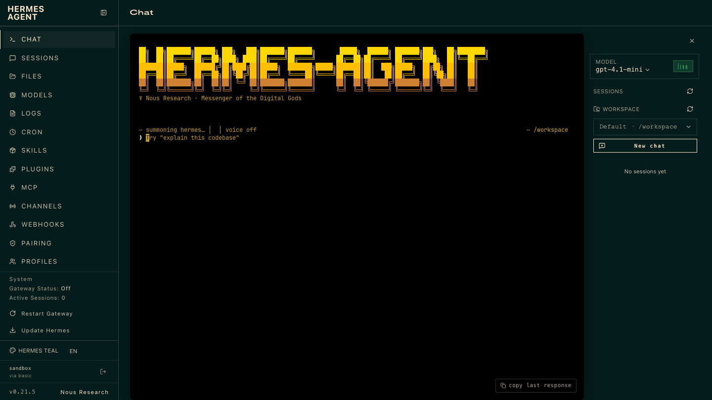
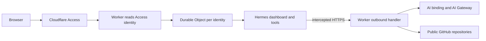

[](https://deploy.workers.cloudflare.com/?url=https://github.com/cloudflare/templates/tree/main/hermes-agent-template)

# Hermes Agent

<!-- dash-content-start -->

Run the [Hermes Agent](https://github.com/nousresearch/hermes-agent) web dashboard, embedded terminal, and coding tools in a separate Linux container for each signed-in user.

- [Cloudflare Access](https://developers.cloudflare.com/cloudflare-one/access-controls/) authenticates users before the Worker starts a workspace.
- [Containers](https://developers.cloudflare.com/containers/) run the unmodified Hermes dashboard. A [Durable Object](https://developers.cloudflare.com/durable-objects/) manages each user's container and proxies HTTP and WebSocket traffic.
- [AI Gateway](https://developers.cloudflare.com/ai-gateway/) routes model requests through the Worker's AI binding. No model API key or Cloudflare API token enters the container.

Workspaces are temporary. Files, sessions, memory, and settings are lost when a container stops or is replaced. Export your work before leaving.

<!-- dash-content-end -->



## Getting started

You need Node.js 22 or later, Docker running locally, a Workers Paid plan, an AI Gateway with Unified Billing configured for `openai/gpt-4.1-mini`, and a Cloudflare Zero Trust organization.

```sh
npm create cloudflare@latest -- hermes-agent --template=cloudflare/templates/hermes-agent-template
cd hermes-agent
```

If prompted to deploy, choose **No** until you finish configuration. If you cloned this repository instead, run `npm ci` inside `hermes-agent-template`.

1. Choose the Worker name in `wrangler.jsonc`. Its hostname is `<worker-name>.<workers-subdomain>.workers.dev`.
2. Create a [self-hosted Access application](https://developers.cloudflare.com/cloudflare-one/access-controls/applications/http-apps/self-hosted-public-app/) for the entire hostname. Select your identity provider and add an **Allow** policy for your intended users. Use a hostname-based application: Worker-level Access policies do not support the terminal's WebSocket connections.
3. Create an [AI Gateway](https://developers.cloudflare.com/ai-gateway/get-started/) and configure [Unified Billing](https://developers.cloudflare.com/ai-gateway/features/unified-billing/).
4. Set the variables below in `wrangler.jsonc`, then deploy with `npm run deploy`.

| Variable        | Value                             |
| --------------- | --------------------------------- |
| `AI_GATEWAY_ID` | The ID of your AI Gateway.        |
| `MODEL`         | `openai/gpt-4.1-mini` by default. |

These are nonsecret identifiers. No Worker secrets or model API keys are required. Every admitted user can consume your model and container budget; set your Access policy and [AI Gateway rate limits](https://developers.cloudflare.com/ai-gateway/features/rate-limiting/) accordingly.

Open the deployed URL and sign in through Access. The first request can take a minute while the container starts. In **Chat**, try:

> Create hello.py and a unittest for it in /workspace. Run the test and explain what you changed.

Approve tool requests when prompted. The Worker handles Hermes's private backend session, so you do not need a second login. Check AI Gateway for successful model requests. Hermes's own “Gateway Status” refers to its messaging gateway, which can be off while Chat works.

## How it works



The Dockerfile pins the upstream Hermes commit and builds the web and terminal assets. `start-dashboard.py` seeds the model settings and enables the `terminal` and `file` toolsets.

The Worker reads the authenticated user UUID from [`ctx.access`](https://developers.cloudflare.com/workers/configuration/cloudflare-access/#read-authenticated-user-identity-with-ctxaccess) and derives the Durable Object ID from it. Requests without an authenticated user cannot start a container. Each Durable Object starts a container with Internet access disabled, waits for readiness, and forwards traffic to port 9119. It replaces incoming credentials with a private Hermes session and strips backend session cookies from responses. Hermes authentication stays enabled.

The container intercepts HTTPS calls to `https://model.internal/v1`. The outbound handler accepts only the configured model, bounds the request size, and calls `env.AI.run()` with your gateway ID and `returnRawResponse: true`. Streaming output and tool calls pass through unchanged. `OPENAI_API_KEY=provided-by-worker` is only a client placeholder. For GPT-4.1 mini, the handler removes Hermes's unsupported `reasoning_effort` option.

The outbound handler also allows unauthenticated HTTPS requests to `github.com`. Other destinations, runtime package downloads, private repositories, and external integrations are not enabled. To support them, adapt the handler and build required tools into the image.

Containers stop after 15 minutes of inactivity. Refreshing a page reuses a running container; an open WebSocket can keep it running. Durable Object storage retains the private backend password, but does not persist container files or Hermes sessions.

## Local development and tests

```sh
npm ci
npm run dev
```

Without an Access identity, the local Worker displays a setup page and does not start a container. Access does not authenticate localhost requests automatically. Use a deployed, Access-protected Worker to exercise sign-in and paid inference. Local tests do not bypass authentication in production code.

```sh
npm run check
npm test
docker build --platform linux/amd64 -t hermes-agent-template:test .
docker run --rm --platform linux/amd64 --network none \
  -v "$PWD/test:/test:ro" hermes-agent-template:test \
  python3 /test/dashboard-smoke.py
```

Unit tests verify Access identity checks, identity isolation, credential stripping, container lifecycle, and the model bridge. The Docker smoke test exercises the real dashboard, WebSocket terminal, and agent tools with a deterministic local model and no paid inference calls.

From the templates repository root, run the setup-page browser tests with:

```sh
pnpm exec playwright test hermes-agent-template.spec.ts
```

## Related resources

- [Run Hermes in a sandbox](https://developers.cloudflare.com/sandbox/coding-agents/hermes/)
- [Hermes web dashboard](https://hermes-agent.nousresearch.com/docs/user-guide/features/web-dashboard)
- [Original example](https://github.com/irvinebroque/nous-research-hermes-agent-cloudflare-sandbox), imported from commit `232a0e08ab394167f54a7f43dd1251876a9862fa`.
